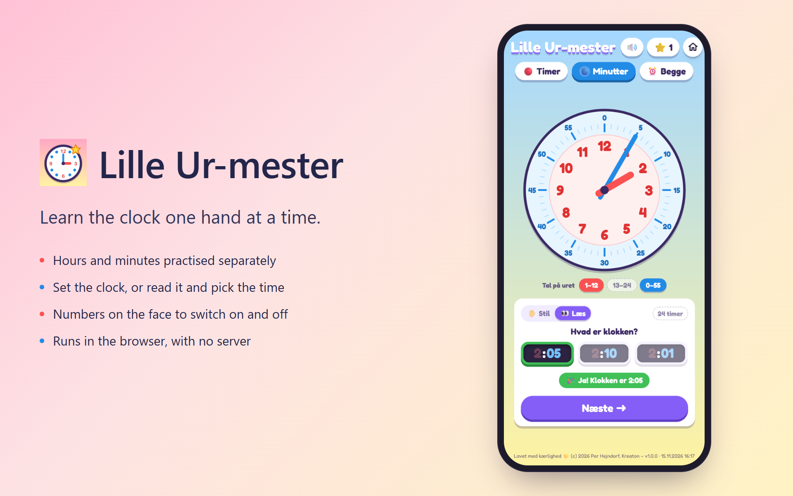

# Lille Ur-mester (ClockMasterEasy)


[](LICENSE)



**A gentle clock game for children who are just starting to read an analogue clock (about 5–8 years).**

▶️ **Play it:** <https://kreaton.github.io/KidsGames/clockmastereasy/>

It is the easy version of [Ur-mester](https://github.com/kreaton/ClockMaster). Ur-mester asks for the whole time at once, as 24-hour digits and in words such as "kvart i fire". Lille Ur-mester breaks it into small steps and leaves the words out. It is a Blazor WebAssembly app (.NET 10) that runs entirely in the browser, with no server or backend. The game itself is in Danish.

## How to play

Pick what to practise:

| | Topic | What moves |
|---|---|---|
| 🔴 | **Timer** | Only the little red hour hand. The big hand stays on 12, so every time is a whole hour. |
| 🔵 | **Minutter** | Only the big blue minute hand. The hour hand already shows its part and is faded. |
| ⏰ | **Begge** | Both hands, once the first two are easy. |

Then pick how:

- **✋ Stil (set):** a digital time is shown. Turn the hand to it and press **Tjek**.
- **👀 Læs (read):** the clock shows a time. Pick the matching digital time from three. The wrong answers are the mistakes children really make: reading the number the minute hand points at (hand on 4 → "4" instead of "20"), mixing up the two hands, or being one hour off.

A right answer gives a star and a ding-dong chime. Every tenth star gives a trophy and confetti.

## Help along the way

- **One colour per hand.** Hours are red and minutes blue everywhere: on the hands, the numbers on the face, the digits of the digital clock and the topic buttons. The part of the time not being practised is dimmed.
- **Numbers on the face.** Chips under the clock switch them on and off: **1–12** for the hours, **13–24** in a small inner ring, and **0–55** around the edge for the minutes. Turn them off one by one as a challenge.
- **24 timer.** Also asks the hours 13–23 (never midnight) and shows a picture for the part of the day (🌅 ☀️ 🌆 🌙), so 3:00 and 15:00 can be told apart without words.
- **Easy to move.** Drag a hand, or tap where it should point; it snaps to the nearest hour or five minutes. In *Begge*, the inner pink disc moves the hour hand and the outer blue ring the minute hand. The arrow keys and Enter work too.
- **Hints.** After two wrong tries, the right place on the face starts to glow. In *Begge*, the message says which hand is already right.

The chosen topic, mode and numbers are remembered in the browser. The hour hand points straight at the hour and does not creep along with the minutes, as in Ur-mester.

## Project layout

```
ClockMasterEasy.slnx
src/ClockMasterEasy/
  Game/EasyGame.cs          Picks the time, checks the hands and makes the three answers to choose from
  Pages/Home.razor          The clock face (an SVG drawn in Razor) and the game screen
  wwwroot/
    index.html              Host page, <base href>
    css/app.css             All styling and animations
    js/clock.js             Dragging and tapping on the clock face, and the saved settings
    js/sounds.js            Tick, chime, trophy and try-again sounds (Web Audio API, no audio files)
    manifest.webmanifest
    icons/                  App icons and favicon
tools/make-icons.ps1        Draws the icons (and copies icon-512.png to KidsGames/billeder/clockmastereasy.png)
```

## Running locally

Requires the [.NET 10 SDK](https://dotnet.microsoft.com/download).

```bash
dotnet run --project src/ClockMasterEasy
```

Then open http://localhost:5319.

Stop the app before building it again. A running dev server keeps the list of files it started with, and after a rebuild the page can hang on "Indlæser".

## Publishing

Pushing to `main` builds the app and puts it in the `clockmastereasy/` folder of the KidsGames GitHub Pages site (<https://kreaton.github.io/KidsGames/clockmastereasy/>) with [`.github/workflows/deploy.yml`](.github/workflows/deploy.yml). It needs the repository secret `PAGES_DEPLOY_KEY`: the private half of a deploy key with write access to `kreaton/KidsGames`.

The app is served from a `clockmastereasy` sub-path: `<base href>` in [`wwwroot/index.html`](src/ClockMasterEasy/wwwroot/index.html) is `clockmastereasy`.

## License

[MIT](LICENSE) © 2026 Per Hejndorf, Kreaton
